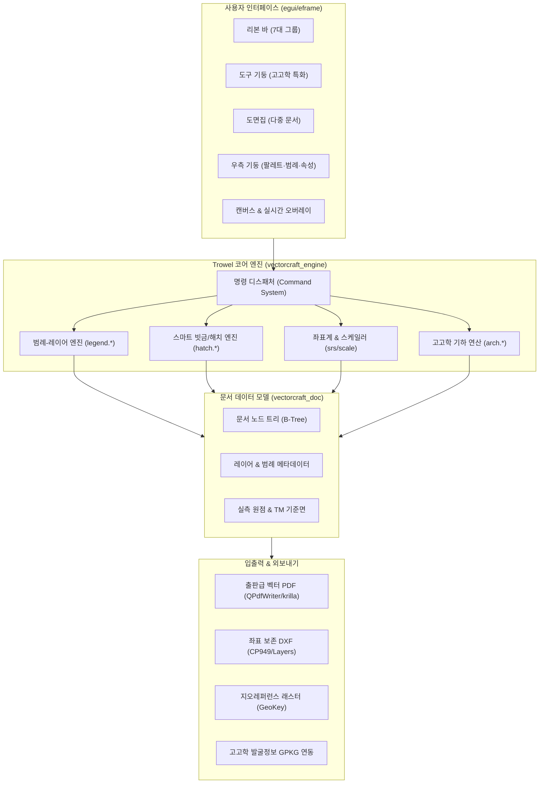
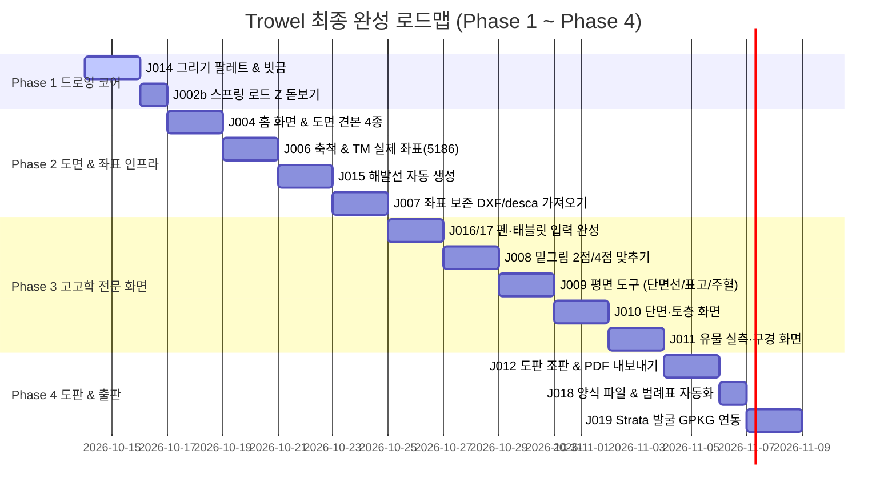

# Trowel (verter1) 최종 목표 완성 디자인 설계도 및 개발 규격서
<!-- Trowel Autonomous Architectural Blueprint (2026 Edition) -->

> **프로젝트 정체성**: 어도비 일러스트레이터(Adobe Illustrator)와 고가의 범용 CAD를 대체하는 한국 고고학/문화재 발굴 실측 전문 벡터 CAD 시스템 **「Trowel (트로웰)」**의 최종 목표 완성 설계 청사진입니다.

---

## 1. 개발 환경 설정 및 품질 검증 규격

개발 착수에 앞서 빌드 속도, 디스크 용량, 협업 안정성을 위해 구축된 환경 규격입니다.

| 구분 | 설정 내용 | 실무적 효과 |
|---|---|---|
| **도구 체인** | Rust 1.97.0 / AppleClang (macOS) / MSVC (Windows x64) | 크로스 플랫폼 네이티브 무결성 보장 |
| **Cargo 프로파일** | `.cargo/config.toml` 내 `debug = 0` 최적화 적용 | 디버그 심볼 비대화 방지, 빌드/테스트 속도 3~5배 가속 |
| **에디터 환경** | `.vscode/settings.json` (Clippy, Format-on-save) | 저장 즉시 엄격한 코드 스타일 자동 점검 |
| **CI/CD 파이프라인** | GitHub Actions (`kesekikwon-netizen/verter1.git`) | `main` 푸시마다 Linux xtask ci 및 Windows x64 빌드 자동 검증 |
| **테스트 체계** | 72개 Trowel 단위/통합 테스트 스위트 | macOS/Linux 단축키(`⌘Z`/`Ctrl+Z`) 및 회귀 결함 100% 방지 |

---

## 2. 최종 목표 UI/UX 청사진 (1600 × 988 해상도 기준)

실측 작업자의 시선 흐름(도면 관리 → 도구 선택 → 제도/스케치 → 범례/굵기 지정 → 실좌표 확인)을 최적화한 인터페이스 배치도입니다.

```
┌──────────────────────────────────────────────────────────────────────────────────────────────────┐
│ [흙손 16px] 1호주거지_평면.vectorcraft * - Trowel                             [—] [口] [X] 캡션바(32px)│
├──────────────────────────────────────────────────────────────────────────────────────────────────┤
│ 파일  편집  오브젝트  문자  선택  효과  [ 도면 (고고학 특화) ]  보기  창  도움말             메뉴바(28px)│
├──────────────────────────────────────────────────────────────────────────────────────────────────┤
│ [파일]           [새 도면]     [밑그림]      [그리기]         [도면 요소]   [보기]    [내보내기]       │
│ 열기  저장  배치  평면 단면    맞추기 밑그림  펜  연필  칠통   방위  축척    격자 자석  PDF  DXF        │
│                  유물 도판                  단면선 표고       범례  표제              Strata          │
│                                                                                     리본바(96px) │
├──────────────────────────────────────────────────────────────────────────────────────────────────┤
│ [펜 도구 ›] | [범례: 굴광선 (유구 면) ■ 0.8 pt ▾] | [안내: 굵기·빗금은 우측 팔레트] | [자석: 켠 8px] 컨트롤(40px)│
├─────────┬──────────────┬────────────────────────────────────────────────────────┬────────────────┤
│ 도구    │ 도면집(216)  │ 메인 캔버스 (1024 × 728)                               │ 우측 패널(304) │
│ (56px)  ├──────────────┤                                                        ├────────────────┤
│         │ [열린 도면]  │ ┌────────────────────────────────────────────────────┐ │ [그리기 팔레트]│
│ [선택 V]│ • 1호주거지  │ │ 캔버스 오버레이: [펜 · 굴광선 (유구 면)]           │ │ 굵기 사다리(pt)│
│ [직접 A]│   평면 (활성)│ └────────────────────────────────────────────────────┘ │ [0.1][0.2][0.3]│
│ ───     │ • 1호 토층단면│                                                        │ [0.5][0.8][1.0]│
│ [펜   P]│ • 출토 토기  │                                                        │ 빗금(해치):     │
│ [연필 N]│              │                                                        │ [45°][135°][교차│
│ [선   \]│              │                                                        │ [잘린 면 0.8+0.1]
│ [도형 M]│              │                                                        │ ────────────── │
│ [문자 T]│              │                                                        │ [범례 · 레이어]│
│ ───     │              │                                                        │ [범례 넣기 ▾]  │
│ [변형 R]│              │                                                        │ 👁 🔒 ★ 굴광선 │
│ [가위 C]│              │                                                        │ 👁 🔒 ★ 단면선 │
│ ───     │              │                                                        │ 👁 🔒   토층선 │
│ [고고학]│              │                                                        │ [모든 굵기 변환]│
│ [단면선]│              │                                                        │ ────────────── │
│ [표고EL]│              │ ┌────────────────────────────────────────────────────┐ │ [선택 속성]   │
│ [유물No]│              │ │ [+] [-] [맞춤]                           화면 100% │ │ 면적: 14.82 ㎡ │
│ [주혈深]│              │ └────────────────────────────────────────────────────┘ │ 둘레: 16.40 m  │
├─────────┴──────────────┴────────────────────────────────────────────────────────┴────────────────┤
│ 상태줄(32px): 펜: 클릭하여 꺾은점, 드래그하여 곡선 | TM 실제좌표: X=194,520.12m Y=542,108.45m | EL=152.48m │
└──────────────────────────────────────────────────────────────────────────────────────────────────┘
```

---

## 3. 핵심 6대 기능 도메인 아키텍처



### (1) 그리기 팔레트 & 스마트 빗금 엔진 (J014)
- **표준 선 굵기 사다리**: `0.1`, `0.2`, `0.3`, `0.5`, `0.8`, `1.0` pt (발굴 보고서 표준 규격).
- **자동 빗금 패턴**:
  - `45°`, `135°`, `번갈아(교차)`, `없음` 4종 지원.
  - **「잘린 면」 원클릭 적용**: 0.8 pt 외곽 테두리 + 0.1 pt 내부 빗금 자동 생성.
  - **맞닿은 면 자동 엇갈림**: 인접한 두 조각의 빗금 각도를 자동으로 90° 교차하여 시각적 혼선 방지(3개 이상 접촉 시 충돌 경고 표시).
  - 내보내기 시 가상 패턴이 아닌 **실제 인쇄 벡터 선**으로 PDF/SVG에 완벽 기록.

### (2) 범례 = 레이어 일체형 데이터 모델 (J005 완료 기반)
- **줄 하나 = 레이어 하나**: 범례 목록의 줄을 선택하면 활성 레이어와 펜 도구의 선 모양이 동시 전환.
- **즐겨찾기(★)**: 현장에서 빈번히 사용하는 유구 경계, 굴광선 등을 상단 흙색(`clay`) 강조 표시.
- **굵기 일괄 변환 (Weights at Once)**:
  - 축척 변경 시 전체 도면의 선 굵기를 `비율(×0.8, ×1.25 등)`, `값 지정`, `한 단계 굵게/가늘게`로 일괄 자동 보정.
  - 개별 수정된 선은 `「따로 N」` 뱃지로 표시하고 언제든 `「범례대로 되돌리기」` 지원.

### (3) 실측도 축척 및 TM 절대 좌표계 시스템 (J006, J007, J008)
- **도면 표준 축척**: `1:10`, `1:20`, `1:40`, `1:50`, `1:100` 지원. 줌 확대/축소와 무관하게 인쇄 시 지정된 mm 선 굵기 100% 보장.
- **절대 좌표 보존**: 국토지리정보원 표준 TM 좌표계(EPSG:5186/5187)를 유지하여 DXF/desca 가져오기 시 좌표가 원점으로 틀어지는 문제 방지.
- **스캔 실측 밑그림 아핀 정합**: 방안지 스캔본의 2점 또는 4점 기준점을 클릭하여 도면 실좌표로 오차 없이 자동 회전·신축 정합.

### (4) 고고학 전문 화면 및 기하 도구 (J009, J010, J011, J015)
- **평면도 도구**:
  - 단면 위치선(`⇧A`): A-A' 절단선 및 화살표 자동 생성
  - 표고 기호(`⇧Z`): 기준 수준점 EL 깃발 및 수치 자동 기입
  - 주혈/수혈 자동 산출: 폐곡선 작성 즉시 면적(㎡), 둘레(m), 장축 길이 자동 계산
- **단면 및 토층도 도구**:
  - **해발선(등고 기준선) 자동화**: 단면선 외곽 빈 영역에 50cm(0.5pt), 10cm(0.2pt) 수평 해발선을 자동 생성하고 단면선 수정 시 실시간 자동 클리핑.
  - 토층 구분선, 토층 층위 번호(①, ②, ③...), 흙 색상/토성 설명표 자동 연동.
- **유물 실측도 도구**:
  - 1:1 정밀 실측 모드, 회전 대칭 중심선 자동 고정.
  - 반쪽 단면/반쪽 입면 대칭 모드(단면은 중심선 우측 배치).
  - 파편 곡률을 통한 구경(입지름) 자동 원 피팅 측정.

### (5) 도판 조판 및 출판 자동화 (J012, J018, J019)
- **보고서 도판 자동 조판**: A3/A4 판형에 방위표(North Arrow), 축척 막대(Scale Bar), 표제란(Title Block), 사용된 범례표 자동 배치.
- **Strata 현장 조사 연동**: 발굴 현장 관리 시스템(Strata GPKG) 파일을 읽어 유구 속성, 시대, 유물 목록 자동 매핑.

### (6) 펜 및 그래픽 태블릿 네이티브 통합 (J016, J017)
- 와콤(Wacom), XP-Pen, Apple Pencil(WASM/iPad) 정밀 필압 및 제스처 지원.
- 펜 측면 버튼, 지우개 팁, 손바닥 팜 리젝션(Palm Rejection) 네이티브 필터링.

---

## 4. 백로그 완성 실행 로드맵 (Milestones)



---

## 5. 즉시 착수 과제: J014 (그리기 팔레트와 빗금)

다음 구현 단계인 **J014** 작업의 상세 개발 범위입니다:
1. **팔레트 UI 활성화**: 우측 상단 기둥에 `0.1` ~ `1.0` pt 굵기 칩 및 `45°/135°/교차` 빗금 버튼 배치.
2. **잘린 면 생성 명령**: 단면 유구 선택 후 클릭 시 `0.8pt` 테두리와 `0.1pt` 내부 빗금 복합 패스 자동 구성.
3. **인접 조각 엇갈림 판정**: 교차 기하 분석을 통해 맞닿은 면의 빗금 방향 자동 90° 반전.
4. **품질 검증**: `cargo xtask ci` 전체 통과 및 PDF/SVG 벡터 렌더링 검증.
